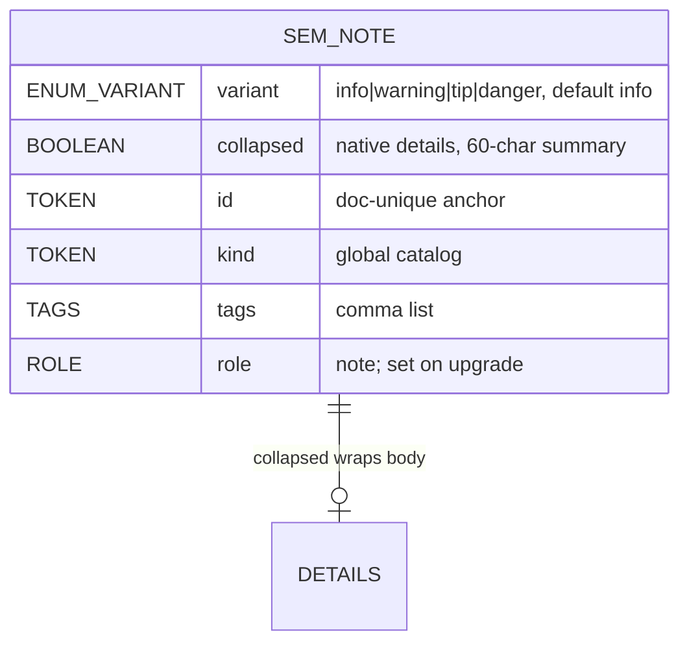

# Data Schema — Summary

Spec-first repo; no relational/KV persistence. Schema = markup contract for
NPL-enhanced XHTML (see [PROJ-SCHEMA.md](PROJ-SCHEMA.md), layout in
[PROJ-LAYOUT.md](PROJ-LAYOUT.md)), machine-backed by
`spec/schema/semtext.schema.json` (the validator's only rule source).

## Core entities

- **Enhanced document** — root `<sem-enhanced-document>` (alias `div.sem-enhanced-document`); metadata children (`agent`, …) + semantic HTML + `sem-*` vocabulary. Canonical form (conventions v0.7): custom elements with **bare attributes** (`<sem-facts view-as="quiz">`, `<sem-step status="done">`).
- **Class-form alias** — the v0.4 spelling (`div/span.sem-*` with `data-*` parameters) maps mechanically from the tag form, one row per element in conventions Appendix A; every tier accepts it. Authoring precedence (conventions §2): `data-<name>` wins when both spellings are on one element. Runtime state the tiers write (`data-active`, toggled `data-view-as`, tier markers) is always `data-*`.
- **Vocabulary scope** — 88 per-element schemas under `spec/schema/`: 43 `sem-*` + 21 `npl/*` + 15 `agent-kit/*` + 9 `semext/*`.
- **Extraction** — minting types return authored content; `sem-reader` is chrome (skipped whole); `sem-source` is transparent (children extract as if unwrapped); `sem-table` rows return in authored order via `data-sem-source-index` (the one DOM-reorder exception).
- **Global attributes** — `kind`, `tags`, `view-as` (unknown ⇒ list fallback), `status` (`done|current|todo|blocked|pass|fail`), `controls`, `collapsed`, `id`, `data-*`. Attributes canonical; inline notation is sugar.

## sem-note schema

Events: none. Light DOM (searchable). BDD source for `test/e2e/sem-note.cy.js`.

## Data files & configs

| Item | Kind |
|------|------|
| `spec/conventions.md` (v0.7) + generated `.html` | canonical spec (md source; `.html` generated by `gen-conventions-html.mjs`, drift-checked in CI) |
| `spec/schema/semtext.schema.json` | machine-readable contract — validator reads it, hardcodes nothing |
| `elements.json` | GENERATED element index (`build:elements-index`) |
| `web/demo/index.html` · `reading-lit.html` · `sem-bind.html` + `data/*` · editor/shell/semext/agent-kit pages | reference + fixture documents (cypress runs on their BUILT copies) |
| `package.json` exports | subpaths only — `./lit` `./npl` `./semext` `./agent-kit` `./lazy` `./npl-lazy` `./semext-lazy` `./agent-kit-lazy` `./agent` `./themes/*` (no `.`); files `dist`, `themes`, `bin`, `src/validate`, `spec/schema`; bins `semtext`, `semtext-validate`, `semtext-agent`; dep `lit ^3.3.3` |
| `vite.config.ts` / `tsconfig.json` / `cypress.config.js` | build / types / e2e config |
