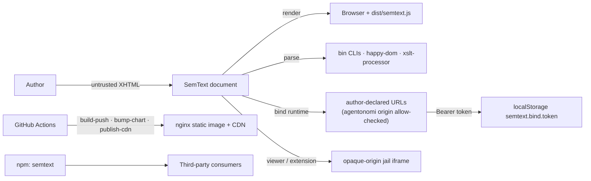

# Threat Model — SemText

## Overview

SemText is a **content-format repo**: its products are XHTML documents, the
one reader bundle (`dist/semtext.js`), namespace companions, and node CLIs.
There is no server-side runtime and no database — the deployed perimeter is
static assets on nginx (`semtext.dev`), npm/CDN artifacts, and CI. The
crown jewels are **trust in the format itself**: a document that can run
script the author did not intend, or an artifact chain that can be
tampered with between build and consumer, breaks the core contract
("chrome mints nothing"; extraction invariant).

Trust boundaries that matter:

1. **Untrusted document → browser runtime** — any SemText page is authored
   content rendered by the bundle; the format must not let it escalate to
   script.
2. **Untrusted document → CLIs / agents** — `bin/semtext*.mjs` parse
   arbitrary documents on developer and agent machines.
3. **Build → consumer** — npm package, CDN assets, and the nginx-served
   `dist/` must arrive unmodified.
4. **Document → remote data** — the bind runtime fetches author-declared
   URLs and holds a Guardian access token.

→ *See [threats/attack-surface.md](threats/attack-surface.md) for the full enumeration*

## Attack Surface

→ *See [threats/attack-surface.md](threats/attack-surface.md) for details*

## Vulnerability Register

| ID | Severity | STRIDE | Component | Status |
|----|----------|--------|-----------|--------|
| T-001 | High | Tampering / Elevation | Untrusted document injects script via vocabulary or Markdown path | Partial — Markdown parser is `createElement`/`textContent` only (no innerHTML); Lit templates escape by default; **attribute-borne URL schemes (`href`/`src`) are not centrally deny-listed** |
| T-002 | Medium | Info disclosure | bind runtime token: `localStorage` + `#access_token` fragment | Mitigated — per-origin key, state-nonce verification, fragment stripped after intake; residual: any XSS reads the token (see T-001) |
| T-003 | Medium | Tampering / Info disclosure | bind runtime fetches author-declared URLs (in-browser exfil channel) | Partial — auth route origin-checked against `AGENTONOMI_ORIGIN`; arbitrary plan/status URLs allowed **by design** (document author is trusted) |
| T-004 | Medium | Tampering | Supply chain: npm/CDN artifact integrity for downstream consumers | Open — no publish automation or integrity documentation; Dependabot reports 3 findings on the default branch (1 high, 2 moderate) |
| T-005 | Medium | Elevation (local) | CLIs parse untrusted XHTML via `happy-dom` / `xslt-processor` on dev/agent machines | Open — parser vulnerabilities would execute locally; exposure bounded to machines that run `semtext-validate`/`semtext` on untrusted input |
| T-006 | Low | DoS | Bundle size/regression creep | Mitigated — `build:strict` budget gate fails CI; shell/editor/nano report-only by decision |
| T-007 | Low | Tampering | Spec drift: `conventions.html` diverging from `conventions.md` | Mitigated — `gen:conventions:check` gate |
| T-008 | Low | Info disclosure | Remote documents rendered in viewer/extension | Mitigated — opaque-origin sandbox iframes (`sandbox` without `allow-same-origin`, sandbox CSP, passive remote resources) |
| T-009 | Low | Repudiation | Chart-tag tampering in deploy path | Mitigated — `bump-chart` is CI-bot-only; hand edits are forbidden by policy |

## Mitigation Coverage

5 mitigated · 2 partial · 2 open. The load-bearing open items are **T-001**
(central attribute-URL policy) and **T-004** (artifact integrity for
consumers); T-005 is accepted for CLI users pending a need.

→ *See [threats/supply-chain.md](threats/supply-chain.md) and [threats/cli-input.md](threats/cli-input.md) for control details*

## Residual Risk

- **Document authors are trusted for data access** (T-003): the bind
  runtime will fetch whatever URLs the document declares — the format's
  contract treats authoring as privilege, matching the "document is the
  data" architecture.
- **Token lifetime** (T-002): the bind token sits in `localStorage` until
  expiry; rotation and revocation are the auth server's concern, not the
  bundle's.
- **CLI parser exposure** (T-005): accepted while CLIs are developer/agent
  tooling; revisit if `semtext-validate` ever gates third-party uploads.
